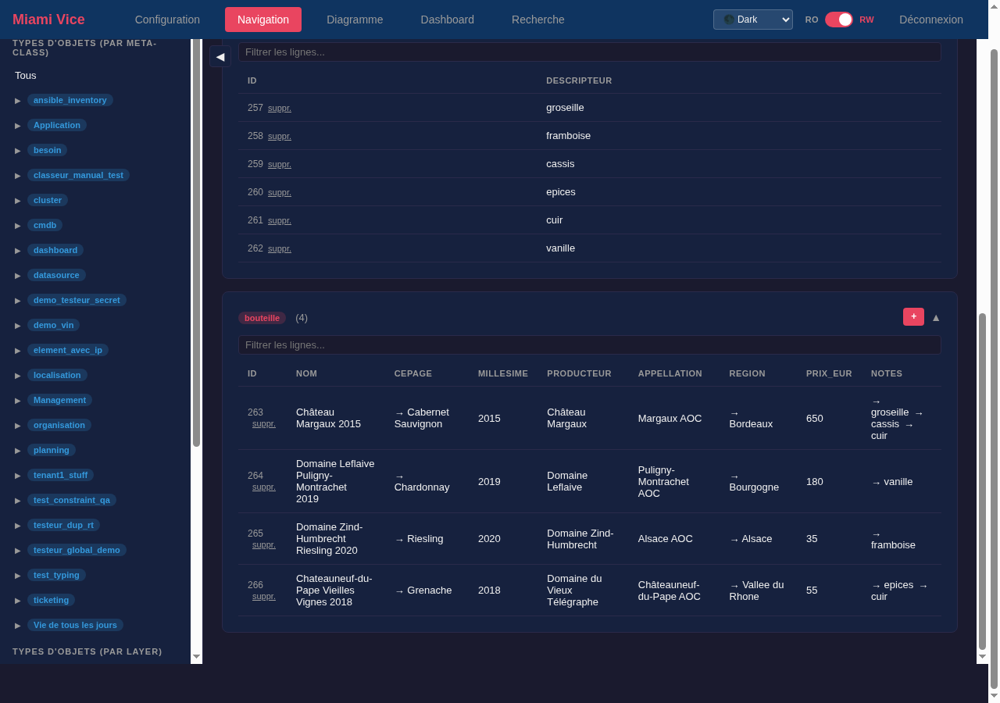
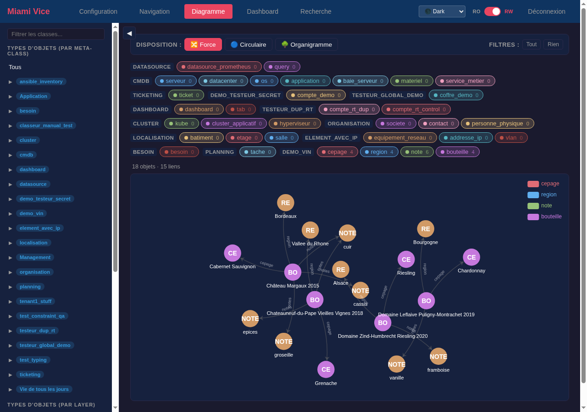

# Mode d'emploi illustré

> Documentation construite action par action (plan-mark4.md action 3,
> scindée en 3a/3b/3c/3d). Chaque section ci-dessous illustre, avec des
> captures d'écran réelles de l'IHM, comment modéliser une classe
> d'objets puis créer/consulter des instances, sur un exemple concret
> différent à chaque fois. L'introduction et la mise en cohérence
> d'ensemble (3d) seront complétées une fois les 3 exemples livrés.

Chaque exemple suit le même déroulé :

1. Un modèle de démonstration est défini dans un fichier
   `model/demo_*.json` (chargé via `POST /api/init`, comme n'importe quel
   autre fichier du dossier `model/`).
2. Des instances réelles sont créées via l'API backend
   (`POST /api/write/object`).
3. Des captures d'écran réelles montrent le résultat : la/les classe(s)
   modélisée(s) côté **Configuration** (`ConfigurationPage.tsx`), les
   instances créées côté **Navigation** (`NavigationPage.tsx`), et le
   graphe des relations côté **Diagramme** (`DiagramPage.tsx`).

## Exemple 1 : bouteille de vin

Modèle de démonstration grand public, pensé pour être compréhensible sans
connaissance préalable du produit : meta-classe `demo_vin` (fichier
[`model/demo_vin.json`](../model/demo_vin.json)), 4 classes :

- `bouteille` : la classe principale.
- `cepage`, `region`, `note` : des classes de référence dédiées, reliées à
  `bouteille` par des **jointures** plutôt que de simples attributs texte
  libre - c'est ce qui permet au **Diagramme** (vue graphe) de matérialiser
  des arêtes réelles entre objets (une chaîne de caractères plate n'en
  produit aucune).

### Les classes modélisées

**`bouteille`**

| Domaine | Attribut | Type | Description |
|---|---|---|---|
| details | `nom` | string | Nom de la bouteille (sert de displayname `{{nom}}`) |
| details | `cepage` | joint-1-1 → `cepage` | Cépage principal |
| details | `millesime` | integer | Année de récolte |
| origine | `producteur` | string | Cave / vigneron |
| origine | `appellation` | string | Appellation d'origine contrôlée (AOC) |
| complement | `region` | joint-1-1 → `region` | Région viticole |
| complement | `prix_eur` | float | Prix indicatif en euros |
| degustation | `notes` | joint-1-n → `note` | Descripteurs de dégustation (plusieurs possibles par bouteille) |

**`cepage`** et **`region`** : une classe de référence minimale chacune,
un seul attribut `nom` (string) - ex. "Cabernet Sauvignon", "Bordeaux".

**`note`** : une classe de référence pour les descripteurs de dégustation,
un seul attribut `descripteur` (string) - ex. "groseille", "framboise",
"cassis", "épices", "cuir", "vanille".

Toutes les classes sont taguées avec le layer `demo` (champ `layers`,
mécanisme déjà utilisé par les autres modèles du projet pour filtrer
l'IHM/les diagrammes par thème).

Capture d'écran de la page **Configuration** montrant la classe
`bouteille`, son attribut `cepage` en `joint-1-1` et la liste des classes
cibles possibles (`cepage` y figure, en surbrillance) :

### Les instances créées

Pour peupler les jointures, les objets de référence suivants ont d'abord
été créés :

- `cepage` : Cabernet Sauvignon, Chardonnay, Riesling, Grenache.
- `region` : Bordeaux, Bourgogne, Alsace, Vallée du Rhône.
- `note` : groseille, framboise, cassis, épices, cuir, vanille.

Puis 4 bouteilles distinctes, chacune reliée à un cépage, une région et un
ou plusieurs descripteurs de dégustation :

| Nom | Cépage | Millésime | Producteur | Appellation | Région | Prix (€) | Notes |
|---|---|---|---|---|---|---|---|
| Château Margaux 2015 | Cabernet Sauvignon | 2015 | Château Margaux | Margaux AOC | Bordeaux | 650 | groseille, cassis, cuir |
| Domaine Leflaive Puligny-Montrachet 2019 | Chardonnay | 2019 | Domaine Leflaive | Puligny-Montrachet AOC | Bourgogne | 180 | vanille |
| Domaine Zind-Humbrecht Riesling 2020 | Riesling | 2020 | Domaine Zind-Humbrecht | Alsace AOC | Alsace | 35 | framboise |
| Chateauneuf-du-Pape Vieilles Vignes 2018 | Grenache | 2018 | Domaine du Vieux Télégraphe | Châteauneuf-du-Pape AOC | Vallée du Rhône | 55 | épices, cuir |

Château Margaux 2015 illustre à elle seule le `joint-1-n` : 3 notes de
dégustation distinctes rattachées à la même bouteille.

Capture d'écran de la page **Navigation** montrant la table `bouteille`
avec les jointures résolues en displayname (`→ Cabernet Sauvignon`,
`→ Bordeaux`, `→ groseille → cassis → cuir`...) :

### Le graphe des relations (Diagramme)

C'est la page **Diagramme** qui tire parti du choix de modéliser
`cepage`/`region`/`notes` en jointures plutôt qu'en texte libre : chaque
jointure devient une arête du graphe (vue ECharts, disposition "Force").
On y voit par exemple Château Margaux 2015 reliée à son cépage (Cabernet
Sauvignon), sa région (Bordeaux) et ses 3 notes de dégustation (groseille,
cassis, cuir) :

### Note technique : captures authentifiées en headless

L'IHM est une *single-page app* sans routage par URL (l'onglet affiché est
un simple état React en mémoire, `frontend/src/App.tsx`) et son jeton
d'authentification est stocké côté client en `localStorage`
(`miami-vice-auth-token`, origine `http://localhost:3000`). Un simple
`google-chrome --headless=new --screenshot=...` one-shot ne suffit donc
pas : il faut piloter le navigateur après son premier rendu (poser le
token, cliquer les onglets/filtres) avant de déclencher la capture.

La solution retenue (documentée et réutilisable pour les exemples
suivants) pilote Chrome headless via le **Chrome DevTools Protocol**
(websocket), avec le script
[`tools/screenshot_demo.py`](../tools/screenshot_demo.py) :

1. Chrome est lancé en amont avec le CDP exposé en HTTP
   (`--remote-debugging-port=9333 --remote-allow-origins=*`).
2. Le script navigue une première fois vers `http://localhost:3000` (pour
   être sur la bonne origine), pose le jeton Keycloak en `localStorage`
   via `Runtime.evaluate`, puis recharge la page pour démarrer
   authentifié.
3. Il simule ensuite les clics nécessaires (onglet Configuration/
   Navigation/Diagramme, sélection de la meta-classe dans la Sidebar,
   `scrollIntoView` jusqu'à la classe visée quand plusieurs classes sont
   chargées) toujours via `Runtime.evaluate` (recherche d'éléments par
   texte, `.click()`).
4. Pour la page Diagramme, un délai supplémentaire laisse le temps à la
   disposition "Force" d'ECharts (simulation physique itérative) de se
   stabiliser avant la capture.
5. La capture finale est prise avec `Page.captureScreenshot`, décodée
   depuis sa réponse base64 et écrite en PNG.

Ce script est générique (paramètres `--page`, `--meta-class`, `--class`,
`--out`) et sera réutilisé tel quel pour les exemples 3b (architecture
applicative / bus Kafka) et 3c (organigramme).
