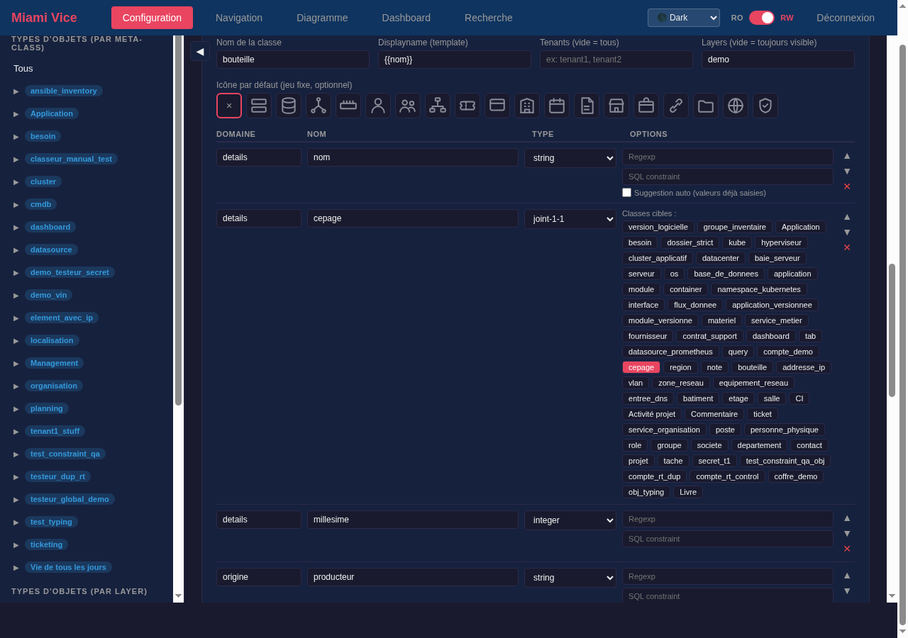
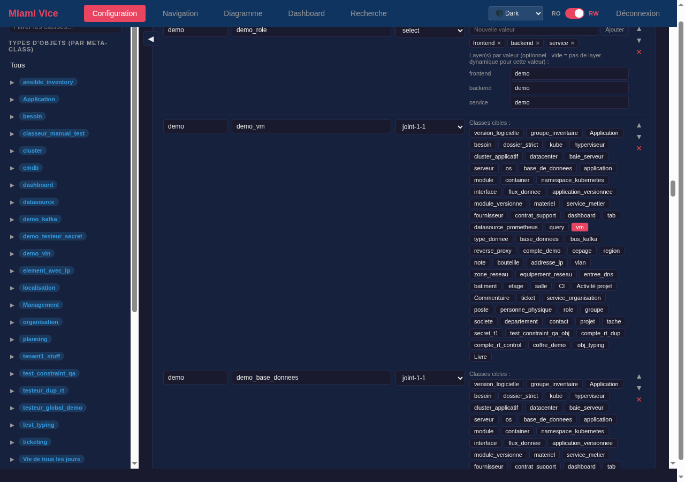
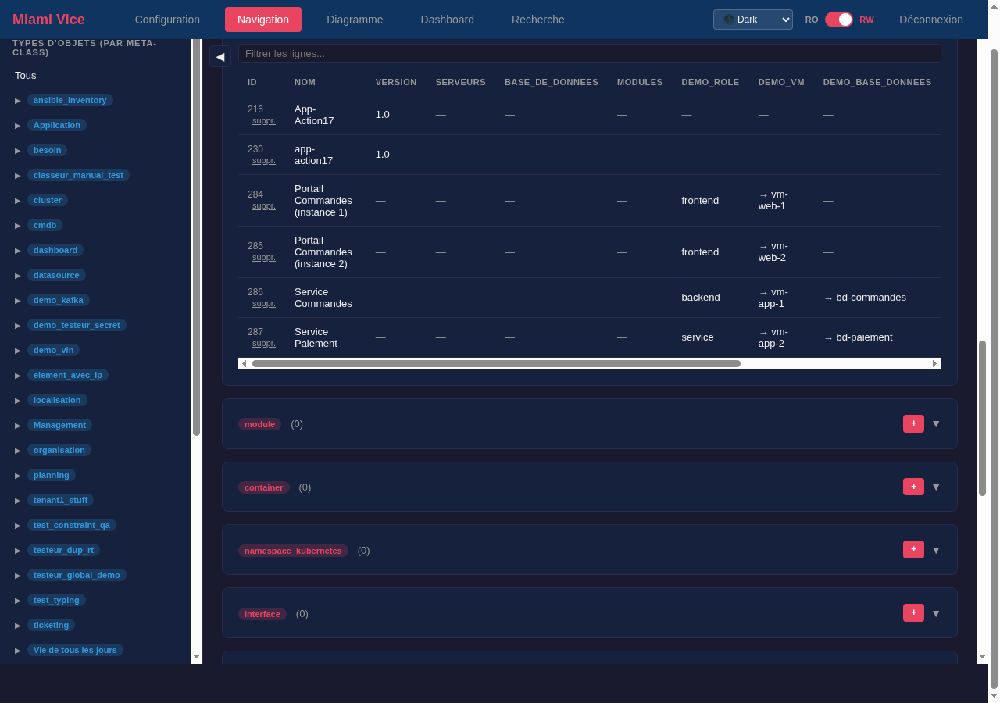
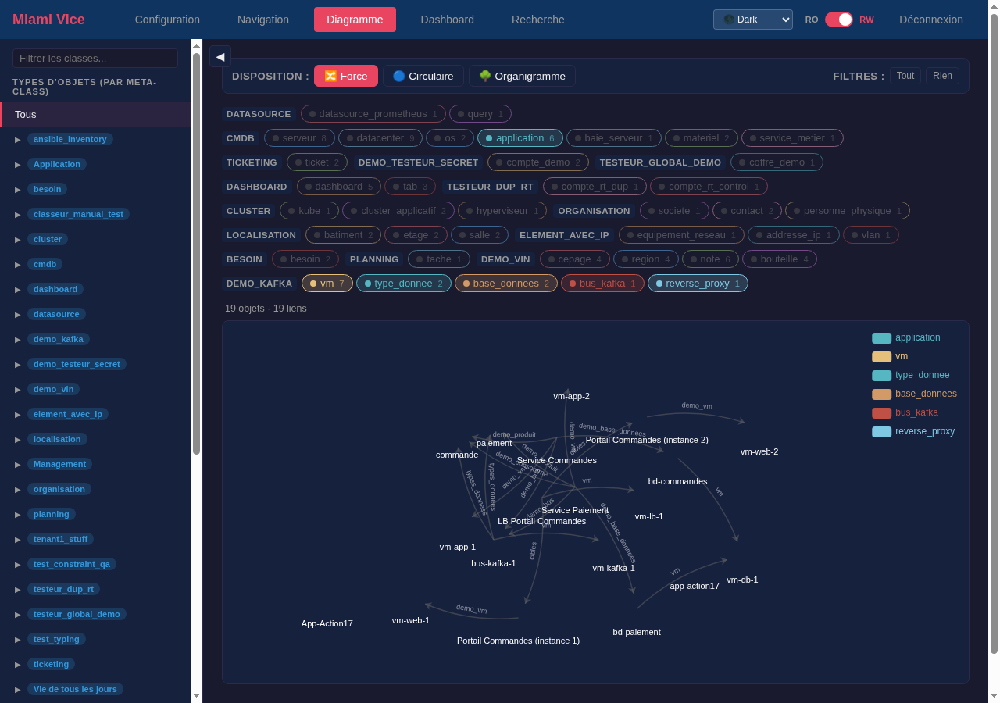

# Mode d'emploi illustré

> Documentation construite action par action (plan-mark4.md action 3,
> scindée en 3a/3b/3c/3d). Chaque section ci-dessous illustre, avec des
> captures d'écran réelles de l'IHM, comment modéliser une classe
> d'objets puis créer/consulter des instances, sur un exemple concret
> différent à chaque fois. L'introduction et la mise en cohérence
> d'ensemble (3d) seront complétées une fois les 3 exemples livrés.

Chaque exemple suit le même déroulé :

1. Un modèle de démonstration est défini dans un fichier
   `model/demo_*.json` (chargé via `POST /api/init`, comme n'importe quel
   autre fichier du dossier `model/`).
2. Des instances réelles sont créées via l'API backend
   (`POST /api/write/object`).
3. Des captures d'écran réelles montrent le résultat : la/les classe(s)
   modélisée(s) côté **Configuration** (`ConfigurationPage.tsx`), les
   instances créées côté **Navigation** (`NavigationPage.tsx`), et le
   graphe des relations côté **Diagramme** (`DiagramPage.tsx`).

## Exemple 1 : bouteille de vin

Modèle de démonstration grand public, pensé pour être compréhensible sans
connaissance préalable du produit : meta-classe `demo_vin` (fichier
[`model/demo_vin.json`](../model/demo_vin.json)), 4 classes :

- `bouteille` : la classe principale.
- `cepage`, `region`, `note` : des classes de référence dédiées, reliées à
  `bouteille` par des **jointures** plutôt que de simples attributs texte
  libre - c'est ce qui permet au **Diagramme** (vue graphe) de matérialiser
  des arêtes réelles entre objets (une chaîne de caractères plate n'en
  produit aucune).

### Les classes modélisées

**`bouteille`**

| Domaine | Attribut | Type | Description |
|---|---|---|---|
| details | `nom` | string | Nom de la bouteille (sert de displayname `{{nom}}`) |
| details | `cepage` | joint-1-1 → `cepage` | Cépage principal |
| details | `millesime` | integer | Année de récolte |
| origine | `producteur` | string | Cave / vigneron |
| origine | `appellation` | string | Appellation d'origine contrôlée (AOC) |
| complement | `region` | joint-1-1 → `region` | Région viticole |
| complement | `prix_eur` | float | Prix indicatif en euros |
| degustation | `notes` | joint-1-n → `note` | Descripteurs de dégustation (plusieurs possibles par bouteille) |

**`cepage`** et **`region`** : une classe de référence minimale chacune,
un seul attribut `nom` (string) - ex. "Cabernet Sauvignon", "Bordeaux".

**`note`** : une classe de référence pour les descripteurs de dégustation,
un seul attribut `descripteur` (string) - ex. "groseille", "framboise",
"cassis", "épices", "cuir", "vanille".

Toutes les classes sont taguées avec le layer `demo` (champ `layers`,
mécanisme déjà utilisé par les autres modèles du projet pour filtrer
l'IHM/les diagrammes par thème).

Capture d'écran de la page **Configuration** montrant la classe
`bouteille`, son attribut `cepage` en `joint-1-1` et la liste des classes
cibles possibles (`cepage` y figure, en surbrillance) :

### Les instances créées

Pour peupler les jointures, les objets de référence suivants ont d'abord
été créés :

- `cepage` : Cabernet Sauvignon, Chardonnay, Riesling, Grenache.
- `region` : Bordeaux, Bourgogne, Alsace, Vallée du Rhône.
- `note` : groseille, framboise, cassis, épices, cuir, vanille.

Puis 4 bouteilles distinctes, chacune reliée à un cépage, une région et un
ou plusieurs descripteurs de dégustation :

| Nom | Cépage | Millésime | Producteur | Appellation | Région | Prix (€) | Notes |
|---|---|---|---|---|---|---|---|
| Château Margaux 2015 | Cabernet Sauvignon | 2015 | Château Margaux | Margaux AOC | Bordeaux | 650 | groseille, cassis, cuir |
| Domaine Leflaive Puligny-Montrachet 2019 | Chardonnay | 2019 | Domaine Leflaive | Puligny-Montrachet AOC | Bourgogne | 180 | vanille |
| Domaine Zind-Humbrecht Riesling 2020 | Riesling | 2020 | Domaine Zind-Humbrecht | Alsace AOC | Alsace | 35 | framboise |
| Chateauneuf-du-Pape Vieilles Vignes 2018 | Grenache | 2018 | Domaine du Vieux Télégraphe | Châteauneuf-du-Pape AOC | Vallée du Rhône | 55 | épices, cuir |

Château Margaux 2015 illustre à elle seule le `joint-1-n` : 3 notes de
dégustation distinctes rattachées à la même bouteille.

Capture d'écran de la page **Navigation** montrant la table `bouteille`
avec les jointures résolues en displayname (`→ Cabernet Sauvignon`,
`→ Bordeaux`, `→ groseille → cassis → cuir`...) :

### Le graphe des relations (Diagramme)

C'est la page **Diagramme** qui tire parti du choix de modéliser
`cepage`/`region`/`notes` en jointures plutôt qu'en texte libre : chaque
jointure devient une arête du graphe (vue ECharts, disposition "Force").
On y voit par exemple Château Margaux 2015 reliée à son cépage (Cabernet
Sauvignon), sa région (Bordeaux) et ses 3 notes de dégustation (groseille,
cassis, cuir) :

### Note technique : captures authentifiées en headless

L'IHM est une *single-page app* sans routage par URL (l'onglet affiché est
un simple état React en mémoire, `frontend/src/App.tsx`) et son jeton
d'authentification est stocké côté client en `localStorage`
(`miami-vice-auth-token`, origine `http://localhost:3000`). Un simple
`google-chrome --headless=new --screenshot=...` one-shot ne suffit donc
pas : il faut piloter le navigateur après son premier rendu (poser le
token, cliquer les onglets/filtres) avant de déclencher la capture.

La solution retenue (documentée et réutilisable pour les exemples
suivants) pilote Chrome headless via le **Chrome DevTools Protocol**
(websocket), avec le script
[`tools/screenshot_demo.py`](../tools/screenshot_demo.py) :

1. Chrome est lancé en amont avec le CDP exposé en HTTP
   (`--remote-debugging-port=9333 --remote-allow-origins=*`).
2. Le script navigue une première fois vers `http://localhost:3000` (pour
   être sur la bonne origine), pose le jeton Keycloak en `localStorage`
   via `Runtime.evaluate`, puis recharge la page pour démarrer
   authentifié.
3. Il simule ensuite les clics nécessaires (onglet Configuration/
   Navigation/Diagramme, sélection de la meta-classe dans la Sidebar,
   `scrollIntoView` jusqu'à la classe visée quand plusieurs classes sont
   chargées) toujours via `Runtime.evaluate` (recherche d'éléments par
   texte, `.click()`).
4. Pour la page Diagramme, un délai supplémentaire laisse le temps à la
   disposition "Force" d'ECharts (simulation physique itérative) de se
   stabiliser avant la capture.
5. La capture finale est prise avec `Page.captureScreenshot`, décodée
   depuis sa réponse base64 et écrite en PNG.

Ce script est générique (paramètres `--page`, `--meta-class`, `--class`,
`--out`) et sera réutilisé tel quel pour les exemples 3b (architecture
applicative / bus Kafka) et 3c (organigramme).

## Exemple 2 : architecture applicative / bus Kafka

Modèle de démonstration technique/professionnel, plus riche que l'exemple
grand public de la section précédente : meta-classe `demo_kafka` (fichier
[`model/demo_kafka.json`](../model/demo_kafka.json)), 5 classes modélisant
une architecture applicative simple autour d'un bus Kafka central, **plus
la classe `application` de la meta-classe `cmdb`** (fichier
[`model/itil_cmdb.json`](../model/itil_cmdb.json), déjà existante pour la
CMDB métier - voir note de révision ci-dessous) - encore une fois, les
relations entre composants (application → VM, application → base de
données, application → bus, bus → types de données, reverse proxy →
applications) sont modélisées en **jointures** plutôt qu'en texte libre,
pour la même raison qu'en Exemple 1 : seules les jointures produisent des
arêtes exploitables dans le **Diagramme**.

> **Révision post-revue croisée (2026-11-26)** : la version initiale de cet
> exemple déclarait sa propre classe `application` sous la meta-classe
> `demo_kafka`, qui entrait en collision de nom avec la classe `application`
> déjà existante dans `model/itil_cmdb.json` (meta-classe `cmdb`) - deux
> classes distinctes portant le même nom, chacune référencée uniquement par
> son nom (pas de qualification par meta-classe) dans les jointures de tout
> le modèle. `POST /api/init` ne détectait pas ce doublon (gap pré-existant,
> hors scope de ce correctif) et le frontend (`Sidebar.tsx`) comparait la
> sélection active par nom de classe seul, pas meta-classe + classe : en
> pratique, sélectionner `demo_kafka > application` surlignait aussi
> `cmdb > application` par erreur. Décision utilisateur après présentation
> du compromis : plutôt que de renommer la classe de démo, **réutiliser la
> classe `application` existante de `cmdb`** pour les objets de démo Kafka -
> plus aucune 2e classe `application` du tout. Les attributs CMDB déjà en
> place sur cette classe (`nom`, `version`, `serveurs`, `base_de_donnees`,
> `modules`) sont inchangés ; les attributs nécessaires à cette démo ont été
> ajoutés à côté, préfixés `demo_` et rangés dans un domaine dédié `demo`
> (voir tableau ci-dessous) pour rester visuellement distincts des
> attributs CMDB métier réels dans la page **Configuration**.

### Les classes modélisées

| Classe | Meta-classe | Rôle |
|---|---|---|
| `vm` | `demo_kafka` | Machine virtuelle d'hébergement (attributs `nom`, `ip`) - classe de référence, cible de jointure depuis la plupart des autres classes. |
| `type_donnee` | `demo_kafka` | Type de donnée échangé sur le bus (attribut `nom`, ex. `commande`, `paiement`) - classe de référence. |
| `base_donnees` | `demo_kafka` | Base de données d'une application (`nom`, `moteur`, `vm` en `joint-1-1`). |
| `bus_kafka` | `demo_kafka` | Le bus Kafka central (`nom`, `vm` en `joint-1-1`, `types_donnees` en `joint-1-n` vers `type_donnee` - les types qui y transitent). |
| `application` | `cmdb` | La classe principale, **partagée avec la CMDB métier réelle** (voir note de révision ci-dessus) : ses attributs CMDB (`nom`, `version`, `serveurs`, `base_de_donnees`, `modules`) plus les attributs de démo `demo_role` (`select` : `frontend`/`backend`/`service`), `demo_vm` en `joint-1-1`, `demo_base_donnees` en `joint-1-1`, `demo_bus` en `joint-1-1`, `demo_produit`/`demo_consomme` en `joint-1-n` vers `type_donnee` (relation producteur/consommateur). |
| `reverse_proxy` | `demo_kafka` | Load balancer devant une ou plusieurs instances d'`application` (`nom`, `vm` en `joint-1-1`, `cibles` en `joint-1-n` vers `application`, désormais la classe `cmdb`). |

Détail des attributs de démo ajoutés à la classe `application` (domaine
`demo`, à côté des attributs CMDB existants inchangés) :

| Domaine | Attribut | Type | Description |
|---|---|---|---|
| demo | `demo_role` | select (frontend/backend/service) | Distingue explicitement frontend et backend |
| demo | `demo_vm` | joint-1-1 → `vm` (demo_kafka) | VM qui héberge l'application |
| demo | `demo_base_donnees` | joint-1-1 → `base_donnees` (demo_kafka) | Base de données de l'application (absente pour un frontend stateless - choix assumé, voir plus bas). À ne pas confondre avec l'attribut CMDB existant `base_de_donnees` (avec "de"), qui pointe vers une classe CMDB différente (`base_de_donnees`) et n'est pas réutilisé ici. |
| demo | `demo_bus` | joint-1-1 → `bus_kafka` (demo_kafka) | Bus Kafka auquel l'application est connectée |
| demo | `demo_produit` | joint-1-n → `type_donnee` (demo_kafka) | Type(s) de donnée publiés sur le bus |
| demo | `demo_consomme` | joint-1-n → `type_donnee` (demo_kafka) | Type(s) de donnée consommés depuis le bus |

Les 5 classes de `demo_kafka` sont taguées avec le layer `demo`, comme en
Exemple 1 ; la classe `application` (`cmdb`), partagée avec la CMDB métier
réelle, ne l'est délibérément pas (un layer est un tag de **classe**, pas
d'instance : le tagger aurait classé à tort les objets CMDB réels existants
sous ce layer de démo).

Choix assumé sur les bases de données : plutôt qu'une base par application
sans exception, le frontend (`Portail Commandes`, stateless) n'a
délibérément pas de `demo_base_donnees` propre, et les deux bases des
applications backend/service sont hébergées sur une VM mutualisée
(`vm-db-1`) - un choix de modélisation réaliste et justifié plutôt qu'une
base par application de façon mécanique.

Capture d'écran de la page **Configuration** montrant la classe
`application` sous le groupe `cmdb` (pas un groupe `demo_kafka` séparé),
avec ses attributs de démo `demo_role` (`select`) et `demo_vm`
(`joint-1-1`, classe cible `vm` en surbrillance parmi toutes les classes du
système) regroupés à part dans le domaine `demo` :

### Les instances créées

17 objets réels ont été créés via `POST /api/write/object` :

- `vm` (7) : `vm-web-1`, `vm-web-2` (2 instances du frontend, redondance),
  `vm-app-1`, `vm-app-2` (les 2 applications backend/service), `vm-kafka-1`
  (le bus), `vm-db-1` (bases de données mutualisées), `vm-lb-1` (reverse
  proxy).
- `type_donnee` (2) : `commande`, `paiement`.
- `base_donnees` (2) : `bd-commandes`, `bd-paiement`, toutes deux sur
  `vm-db-1`.
- `bus_kafka` (1) : `bus-kafka-1`, transportant `commande` et `paiement`.
- `application` (4, sous `cmdb` - voir note de révision) :

| Nom | Rôle | VM | Base de données | Bus | Produit | Consomme |
|---|---|---|---|---|---|---|
| Portail Commandes (instance 1) | frontend | vm-web-1 | — | — | — | — |
| Portail Commandes (instance 2) | frontend | vm-web-2 | — | — | — | — |
| Service Commandes | backend | vm-app-1 | bd-commandes | bus-kafka-1 | commande | — |
| Service Paiement | service | vm-app-2 | bd-paiement | bus-kafka-1 | paiement | commande |

  `Service Commandes` **produit** le type `commande` sur le bus ;
  `Service Paiement` le **consomme** et **produit** à son tour `paiement` -
  la relation producteur/consommateur illustrée concrètement par deux
  applications distinctes reliées au même bus.
- `reverse_proxy` (1) : `LB Portail Commandes` (sur `vm-lb-1`), ses
  `cibles` pointant vers les 2 instances de `Portail Commandes` - illustre
  la redondance + reverse proxy mentionnée en option dans le plan.

Capture d'écran de la page **Navigation** montrant la table `application`
sous `cmdb` : les 4 instances de démo (colonnes `demo_role`/`demo_vm`/
`demo_base_donnees`/...) apparaissent au côté des objets CMDB réels
préexistants de cette même classe (colonnes de démo vides pour ces
derniers) - preuve visuelle qu'il n'y a plus qu'une seule classe
`application` dans tout le système :

### Le graphe des relations (Diagramme)

Le **Diagramme**, filtré sur les 6 classes de cette démo (`vm`,
`type_donnee`, `base_donnees`, `bus_kafka`, `application`, `reverse_proxy`,
réparties sur 2 meta-classes `demo_kafka`/`cmdb`), matérialise les 19
jointures entre les 17 objets de démo : les applications reliées à leur VM,
leur base de données et le bus, le bus relié à ses 2 types de données, et
le reverse proxy relié à ses 2 cibles redondantes. La barre de filtres en
haut du Diagramme montre un seul badge `application`, sous le groupe
`CMDB` (sans doublon), comptant les 4 objets de démo et les objets CMDB
réels préexistants de cette classe (ces derniers apparaissent isolés dans
le graphe, sans arête, n'ayant aucun attribut de démo renseigné) :

### Note technique

Captures produites avec le même outil CDP headless que l'Exemple 1: voir
la [note technique de l'Exemple
1](#note-technique--captures-authentifiées-en-headless) ci-dessus, pas de
duplication ici. Les classes de cette démo étant réparties sur 2
meta-classes (`demo_kafka` et `cmdb`) depuis la révision post-revue
ci-dessus, `tools/screenshot_demo.py` a reçu deux options supplémentaires
pour ce cas (un simple `--meta-class` ne suffit plus à regrouper les 6
classes dans une même capture) : `--only-classes` (page Diagramme,
clique "Rien" puis ré-active uniquement les chips listées) et `--layer`
(alternative additive par le filtre Layers, documentée dans l'outil avec
sa limite : n'isole pas une classe sans layer). Capture Configuration via
`--meta-class cmdb --class application --attr demo_vm` ; capture Navigation
via `--meta-class cmdb --class application` ; capture Diagramme via
`--only-classes vm,type_donnee,base_donnees,bus_kafka,application,reverse_proxy`.
